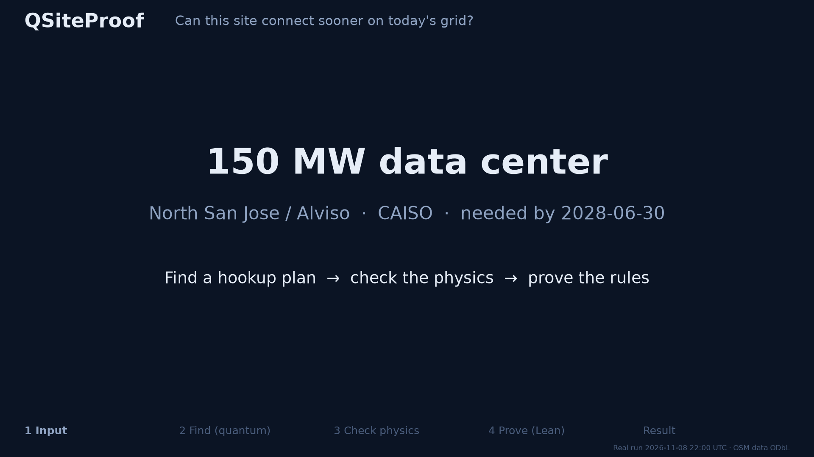
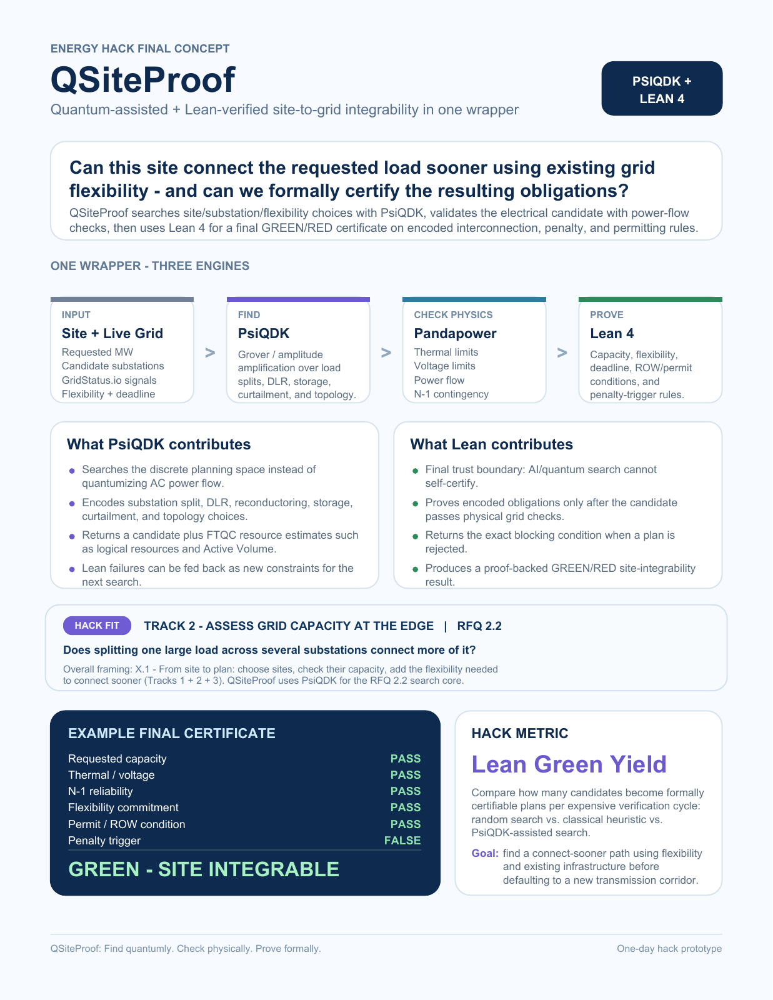

# QGrid - Quantum-Lean for Grid Site Optimization

## QSiteProof

**Quantum-assisted + Lean-verified site-to-grid integrability in one wrapper.**

> Can this site connect the requested load sooner using existing grid flexibility - and can we formally certify the resulting obligations?

QSiteProof is a proposed one-day hack prototype that combines PsiQDK search, pandapower physical checks, and Lean 4 formal certification. The goal is to find a connect-sooner path using flexibility and existing infrastructure before defaulting to a new transmission corridor.

**Status:** Working prototype. The pipeline stages (OpenStreetMap grid + CAISO data, PsiQDK Grover search with a NumPy fallback, pandapower power flow with N-1, Lean 4 certificate with a Python mirror when Lean is not installed) run on the North San Jose / Alviso site; each run labels which engine actually ran. **Current results live in [STATUS.md](STATUS.md)**: since the firm N-1 transformer check (PR #21), 150 MW at transmission is RED (about 19.9 MW firm headroom per candidate substation); the YES-IF path is distribution edge sites plus curtailment. All grid numbers are conditional screening estimates from PG&E GRIP 2028 forecasts and assumed ratings, not utility approvals.

## Interactive 3D WebGL explorer

Explore the North San Jose / Alviso network in an interactive [grid-planning workbench](viz/webgl/). Tune load, growth, routing, batteries, curtailment, line ratings, temperature, deadlines, and permitting conditions to see the 3D routes and **GREEN / AMBER / RED** screening verdict change immediately.

```sh
npm ci --prefix viz/webgl
npm run dev --prefix viz/webgl
```

The single-screen explorer follows **In → Find → Check physics → Prove → Out**. The first panel contains the interactive geographic grid. The second contains a 3D photonic-computer concept and a **Run PsiQDK** action that executes the repository's actual native Workbench circuit, returns measured candidates, phase states, and resource estimates, and rejects fallback results. Local execution also needs `python -m viz.webgl.server.local_api` running from the repository root (Windows uses the existing Ubuntu `~/qsite-venv`).

The browser uses an overall count-based display: 8/8 screens pass is green, exactly 7/8 is yellow, and 6/8 or fewer is red; individual blocking limits stay visible. This does not change the pipeline or Lean verdict. Sliders and the Check / Prove panels are analytical scenario previews; they do not run new AC physics or produce new Lean certificates. The historical GREEN certificate is clearly marked as superseded by the firm N-1 review. See [the explorer README](viz/webgl/README.md) for setup, tests, data refresh, and the Vercel Python runtime.

## Demo: an earlier GREEN run (superseded)

[](docs/demo_green.mp4)

*1920×1080. Click for the MP4.* Recorded at 14:10 PT, **before** the firm N-1 transformer and bank-cap checks landed; the same 150 MW request is RED today (see STATUS.md). Every frame comes from that one pipeline run ([docs/demo_run/](docs/demo_run/)), rendered by [docs/make_demo_video.py](docs/make_demo_video.py):

| Step | What you see | Real result |
| --- | --- | --- |
| **In** | 150 MW data center, Alviso, needed by 2028-06-30 | `data/l1/site.json` |
| **Find (quantum)** | Every hookup plan in superposition → phase flip on the plans that pass → interference amplifies them → measure | PsiQDK simulation: 10 qubits, 1,024 plan slots, 211 pass, 1 Grover iteration; fault-tolerant cost estimate Active Volume 82,770 |
| **Check physics** | pandapower power flow + "what if any single line trips" | Converged, max loading 71.7%, voltage 0.993–1.02 pu, N-1 pass |
| **Prove (Lean 4)** | 7 rules: capacity, thermal/voltage, N-1, flexibility, deadline, permit/ROW, penalty trigger | All pass; kernel-checked theorems; evidence SHA-256 recorded (it did not yet bind plan/site/snapshot ids, being fixed) |
| **Out** | **GREEN**: 112.5 MW Northern Receiving + 37.5 MW Los Esteros, no new corridor | `docs/demo_run/certificate.json` |

GREEN covers only the encoded rules over the supplied evidence; it is not a utility interconnection approval. The quantum search is a PsiQDK simulation of a fault-tolerant algorithm; no quantum advantage is claimed.

[](docs/QSiteProof_Final_Plan_Updated.pdf)

*Click the image to open the original PDF.*

## Case study: North San Jose, Santa Clara County, California

**Selected study area: North San Jose / Alviso.**

> Can a new high-density compute site connect sooner by splitting its requested load across multiple substations and combining existing-grid flexibility, while satisfying formally encoded interconnection and permitting constraints?

### Why this location

- **PG&E capacity screening:** PG&E lists San Jose and Alviso in its service area. Use PG&E GRIP / ICA data to screen candidate connections within PG&E electric territory. Sources: [PG&E service area](https://www.pge.com/en/featured/pge-service-area.html), [PG&E GRIP](https://grip.pge.com/).
- **CAISO signals:** Use live / near-live demand, prices, and congestion context from [GridStatus.io's CAISO dashboard](https://www.gridstatus.io/live/CAISO).
- **Real compute geography:** San Jose's published data-center applications include projects in the Alviso area, providing a concrete setting for a large compute-load study. Source: [City of San Jose data-center and large energy-use projects](https://www.sanjoseca.gov/your-government/departments-offices/planning-building-code-enforcement/planning-division/data-center-and-other-large-energy-use-projects).
- **Substation-splitting question:** Evaluate multiple candidate substations and load allocations against a single-connection baseline, directly addressing **RFQ 2.2: split one large load across several substations**. Candidate connection points and their feasibility will be established during the study.
- **Permitting layer:** Encode the site's applicable zoning, hazard, right-of-way (ROW), deadline, and interconnection conditions as Lean obligations, using San Jose-specific evidence and rules.
- **Nearby comparison case:** The [Energy Hack Track 1 resources](https://github.com/arhamshah08/energy-hack/blob/main/tracks/1-sites/README.md) include City of Santa Clara data-center zoning and permitting material. Use that as a comparison with its own jurisdiction and utility context.

### Utility and jurisdiction boundary

**Santa Clara County** identifies the county containing this North San Jose case study. The **City of Santa Clara** is a separate municipality whose municipal utility, **Silicon Valley Power**, supplies electricity within its city boundaries. A City of Santa Clara comparison requires its own utility data and permitting rules. Source: [California Energy Commission review of Silicon Valley Power's Integrated Resource Plan](https://efiling.energy.ca.gov/GetDocument.aspx?DocumentContentId=102957&tn=265948).

The primary electrical-capacity layer for the North San Jose / Alviso study is PG&E GRIP / ICA. Treat its hosting-capacity values as screening estimates; establish site-specific connection feasibility through the grid model and utility study process. See the [Energy Hack Track 2 capacity-data guidance](https://github.com/arhamshah08/energy-hack/blob/main/tracks/2-grid-capacity/README.md).

### Proposed 150 MW demo

**150 MW North San Jose compute site** → **PsiQDK searches substation splits / flexibility** → **pandapower verifies grid feasibility** → **Lean 4 certifies the encoded obligations** → **SITE INTEGRABLE 🟢**, if all required checks pass.

The 150 MW request is an illustrative scenario input. A rejected candidate returns its blocking condition for the next search iteration.

## One wrapper - three engines

| Stage | Engine / inputs | Role |
| --- | --- | --- |
| **Input** | Site + live grid | Requested MW, candidate substations, GridStatus.io signals, flexibility options, and connection deadline. |
| **Find** | PsiQDK | Grover search / amplitude amplification over load splits, DLR, storage, curtailment, and topology choices. |
| **Check physics** | pandapower | Validate power flow, thermal limits, voltage limits, and N-1 contingency performance. |
| **Prove** | Lean 4 | Check encoded capacity, flexibility, deadline, right-of-way (ROW) / permitting conditions, and penalty-trigger rules; produce a GREEN / RED result. |

### What PsiQDK contributes

- Searches the discrete planning space instead of quantumizing AC power flow.
- Encodes substation splits, DLR, reconductoring, storage, curtailment, and topology choices.
- Returns a candidate plus fault-tolerant quantum computing (FTQC) resource estimates, such as logical resources and Active Volume.
- Can use Lean failure conditions as new constraints for the next search.

### What Lean 4 contributes

- Acts as the final trust boundary: AI / quantum search cannot self-certify.
- Proves encoded obligations only after the candidate passes physical grid checks.
- Returns the exact blocking condition when a plan is rejected.
- Produces a proof-backed GREEN / RED site-integrability result for the encoded rules.

Formal certification is scoped to the encoded obligations and supplied evidence. Physical grid feasibility is checked separately with pandapower.

## Example final certificate

*Illustrative output from the concept plan; not the result of an executed grid study.*

| Check | Example result |
| --- | --- |
| Requested capacity | PASS |
| Thermal / voltage | PASS |
| N-1 reliability | PASS |
| Flexibility commitment | PASS |
| Permit / ROW condition | PASS |
| Penalty trigger | FALSE |
| **Final result** | **GREEN - SITE INTEGRABLE** |

## Hack metric: Lean Green Yield

Compare how many candidates become formally certifiable plans per expensive verification cycle across:

1. Random search.
2. A classical heuristic.
3. PsiQDK-assisted search.

## Hack fit

- **Primary track:** Track 2 - Assess grid capacity at the edge.
- **Search core:** RFQ 2.2 - Does splitting one large load across several substations connect more of it?
- **Overall framing:** X.1 - From site to plan: choose sites, check their capacity, and add the flexibility needed to connect sooner, spanning Tracks 1 + 2 + 3.

QSiteProof uses PsiQDK for the RFQ 2.2 search core, pandapower to check physical feasibility, and Lean 4 to certify the encoded interconnection, penalty, and permitting obligations.

**Find quantumly. Check physically. Prove formally.**
